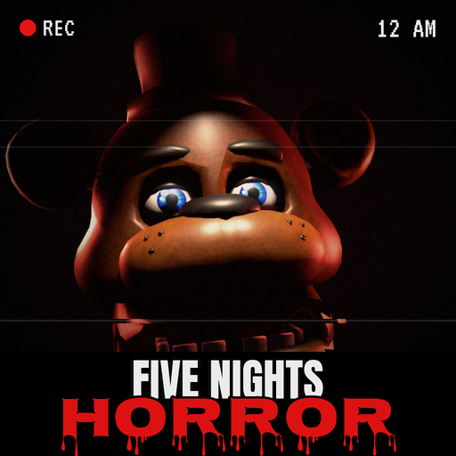
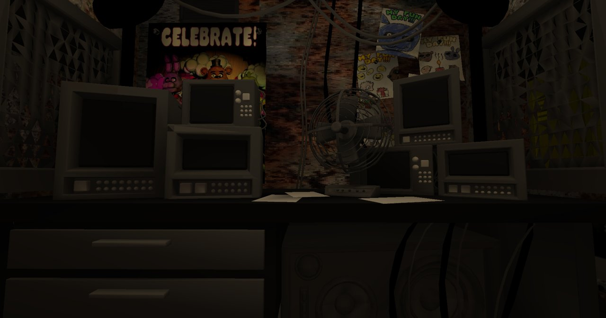
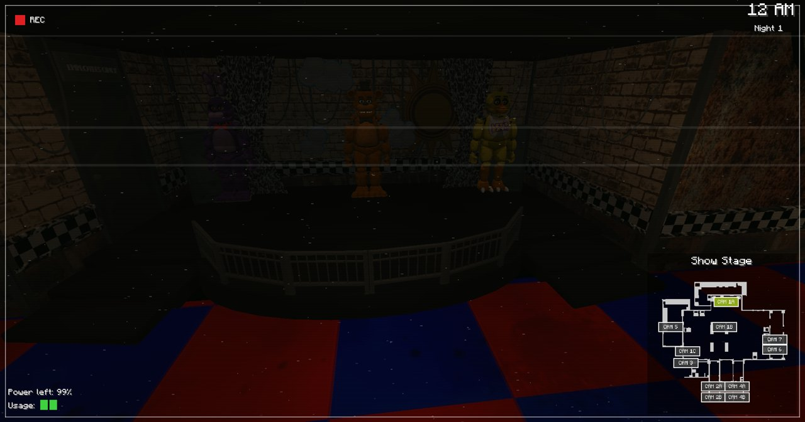
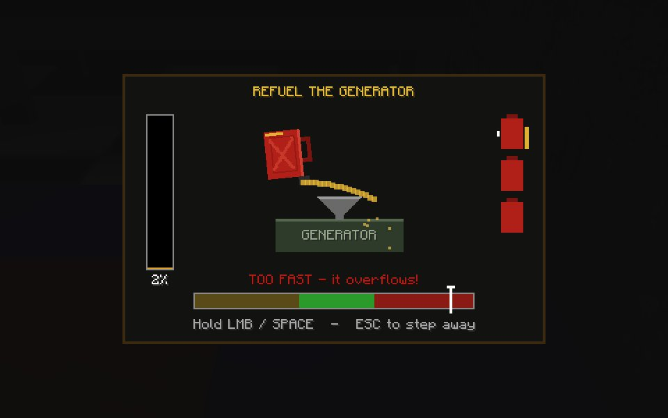
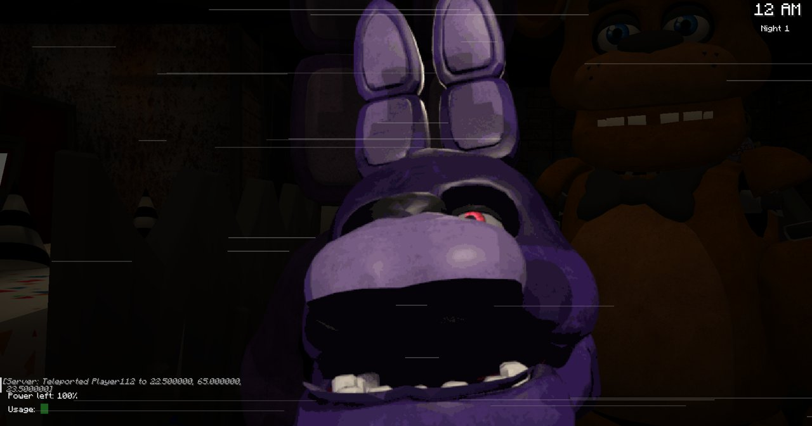

<p align="center"></p>

# Five Nights at Freddy's: Horror

A FNAF 1 horror mod for **Minecraft 1.20.1 (Fabric)** by **Dead Signal Studio**.
Survive five nights as the night guard of Freddy Fazbear's Pizza: watch the cameras, close the doors,
save power — and when the power runs out, go out into the dark to refuel the generator.



## Features

- **The FNAF 1 pizzeria** — the whole map (stage, dining area, Pirate Cove, halls, office, kitchen,
  restrooms) built from a real 3D model, with baked lighting and shadows.
- **Nights 1–6** with the original FNAF 1 AI levels and hour boosts, a 12 AM → 6 AM clock and night progress
  saved per player (New Game / Continue / 6th Night in the main menu).
- **Security cameras** (C) with the FNAF 1 camera map, static and glitches when an animatronic moves.
- **Office doors and hall lights** on the wall buttons; every door, light and the tablet drains **power**.
- **Animatronics**: Bonnie and Chica come down the halls, Freddy moves only when you are not watching,
  Foxy sprints from Pirate Cove. If they **see you** outside the office they run after you.
- **Blackout**: at 0% power petrol cans appear around the pizzeria. Find them with your flashlight and pour
  them into the generator in a **refuel minigame** before Freddy's music box ends.
- **FNAF-style jumpscares** — full-screen pre-rendered frames for every animatronic.
- Optimised map rendering (the map is real block geometry that Minecraft meshes and lights).

| Cameras | Refuel minigame | Jumpscare |
|---|---|---|
|  |  |  |

## Requirements

- Minecraft 1.20.1, Fabric Loader 0.15+
- [Fabric API](https://modrinth.com/mod/fabric-api)
- [GeckoLib 4.8.x](https://modrinth.com/mod/geckolib)

## Building

```bash
./gradlew build          # jar in build/libs/
./gradlew runClient      # dev client
```

Java 17 is required.

## Project layout

| Path | What |
|---|---|
| `src/main/java` | server side: blocks, entities, the night system (`night/`), pizzeria and lobby |
| `src/client/java` | client side: map/door/animatronic renderers, cameras, HUD, menu, jumpscares |
| `src/main/resources/assets/fnaf` | textures, models, sounds, the baked map (`map/fnaf1.fmap`) |
| `tools/pizzeria` | Python generators: map cells + collision (`build_map.py`), night layout, textures, icon |
| `tools/blender` | Blender scripts: map export + light bake, props, jumpscare frames, icon render |
| `tools/sounds` | builds the sounds from CC0 freesound.org recordings |

The Blender source files are not in the repository (they are large); the generated assets are.

## Credits

- FNAF 1 animatronic models — **999angry** (Sketchfab), CC BY 4.0
- FNAF 1 map — **skylajade69** (Sketchfab), CC BY 4.0
- Sounds — CC0 recordings from freesound.org (full list in [`CREDITS.txt`](src/main/resources/assets/fnaf/CREDITS.txt))
- Music box — Bizet's *Toreador Song* (public domain), synthesized

Five Nights at Freddy's and its characters belong to **Scott Cawthon**. This is an unofficial,
non-commercial fan project, not affiliated with or endorsed by him. No assets from the FNAF games are included.

## License

Code and the mod's own assets: [MIT](LICENSE). Third-party assets keep their own licenses (see above).
